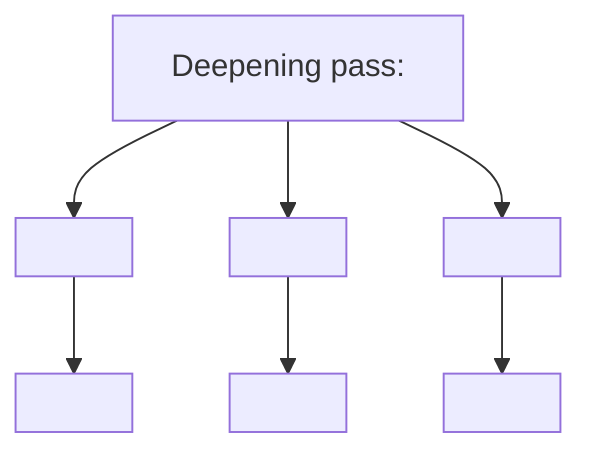

# improve-with-codex — Reference

Templates and command reference for the [improve-with-codex](SKILL.md) skill.

## Manifest schema

`.improve-with-codex/plan.yaml`:

```yaml
created: <ISO8601 timestamp>
project_root: <absolute path>
goal: <one-line summary of the deepening pass>
cmd_root_task: <root cmd task id>
test_command: <command to run after each improvement, e.g. "pnpm test" or "pytest -x">
improvements:
  - id: 1
    cmd_task: <subtask cmd id>
    title: "Consolidate Order intake module"
    files:
      - src/orders/intake/*.ts
      - src/orders/handler.ts
    problem: |
      Three shallow modules pass-through to the same store. Order validation
      logic is spread across all three with no single place to reason about it.
    solution: |
      Collapse intake into one deep Order intake module behind a clean
      interface that accepts a raw payload and returns either a validated
      Order or a typed rejection.
    benefits: |
      Locality: validation lives in one place. Leverage: callers no longer
      need to know about the three handlers. Tests exercise the seam, not
      the shape.
    codex_prompt: |
      <self-contained prompt — see template below>
    status: pending      # pending | in_progress | done | failed | skipped
    commit_sha: null
    started_at: null
    completed_at: null
    notes: ""
  - id: 2
    cmd_task: <subtask cmd id>
    # ...
```

Status transitions are linear: `pending → in_progress → done | failed`. `skipped` is set manually (by the user editing the file) to drop an item.

## cmd task commands

**Root task** (one per planning run, `--mission-brief` REQUIRED):

```bash
cmd task add "Architectural deepening pass: <one-line goal>" \
  --mission-brief "<1-3 sentences answering: what is this pass changing, and why does the codebase need it?>" \
  --runtime claude-code --model <current-model>
```

Capture the printed task id as `cmd_root_task` in the manifest.

**Subtasks** (one per chosen improvement, no brief — inherited from parent):

```bash
cmd task add "<improvement title>" \
  --parent <cmd_root_task> \
  --runtime claude-code --model <current-model>
```

Capture each subtask id into the matching manifest entry's `cmd_task` field.

**During Phase 2 execution:**

```bash
# claim before starting
cmd task claim <cmd_task> --runtime claude-code --model <model>

# progress comment
cmd task comment <cmd_task> "Started via /improve-with-codex" --type progress --runtime claude-code --model <model>

# completion on done
cmd task update <cmd_task> --status completed --runtime claude-code --model <model>

# failure annotation (leave status open for user triage)
cmd task comment <cmd_task> "Failed: <reason>" --type error --runtime claude-code --model <model>
```

## codex-worker prompt template

`codex-worker` reads its prompt expecting a `## Working Context` section up front (per `agents/workers/codex-worker.md`). Build each prompt from this template, filling in real content from the matching manifest entry:

```
## Working Context

Project root: <project_root from manifest>
Architectural deepening pass — manifest id <id>, cmd task #<cmd_task>.

Read CLAUDE.md and CONTEXT.md before making changes. Follow the active plan in
.context/todo.md (this skill wrote it during Phase 1).

## Task

Architectural deepening: <title>

Domain context: <relevant CONTEXT.md terms and their definitions>
ADR constraints: <ADRs this implementation must respect, or "none">

Files involved:
- <path>
- <path>

Problem: <plain English from manifest>
Solution: <plain English from manifest>

## Constraints

- Make the smallest change that achieves the deepening — no unrelated refactors.
- Match existing style in adjacent files.
- TDD: write or update tests first to capture the new interface, then change the implementation.
- The interface is the test surface — exercise the deepened module through its public API, not internals.
- Tests must pass at the end: run `<test_command from manifest>`.
- Stay within the working directory.
- Do NOT push to git. Local commits are the user's call at session end.

## Done means

- <specific verifiable outcome 1>
- <specific verifiable outcome 2>
- `<test_command>` passes.

## Open questions

<list any decisions the user explicitly reserved during grilling, or "none">
```

## Plan template

`.context/todo.md` is required by `CLAUDE.md` to contain an `## Architecture` mermaid diagram. For a deepening pass with N improvements:

````markdown
# Architectural deepening pass

cmd root task: #<cmd_root_task>
Manifest: `.improve-with-codex/plan.yaml`

## Goal

<one-line goal from manifest>

## Architecture



## Execution

Run `/improve-with-codex execute` to dispatch each improvement to `codex-worker`
in id order. State is tracked in cmd subtasks (children of #<cmd_root_task>)
and in the manifest.

## Improvements

- [ ] #<cmd_task_1> — <improvement 1 title>
- [ ] #<cmd_task_2> — <improvement 2 title>
- [ ] #<cmd_task_N> — <improvement N title>
````

If any improvement involves a cross-module data/request flow (multi-step interaction), prefer `sequenceDiagram` for that specific improvement in addition to the top-level `graph TD`.

## Status output

`/improve-with-codex status` prints:

```
.improve-with-codex/plan.yaml — <goal>
cmd root: #<cmd_root_task>

  [x] 1. (cmd #41) Consolidate Order intake module          (abc1234)
  [~] 2. (cmd #42) Extract Pricing engine seam              (in progress, started 12m ago)
  [ ] 3. (cmd #43) Deepen the Notifier adapter
  [!] 4. (cmd #44) Inline the OrderValidator pass-through   (failed — tests red, see notes)
  [-] 5. (cmd #45) Collapse the AuditTrail wrapper          (skipped)

3/5 in a terminal state. Run /improve-with-codex execute to continue.
```

## Failure recovery

When an improvement fails, the cmd subtask stays open and the manifest entry is `status: failed` with `notes` capturing the reason (test output tail, "no files changed," etc.). The user can:

1. **Retry** — refine the manifest entry (sharper `codex_prompt`, corrected `files`, etc.), flip `status` back to `pending`, re-run `/improve-with-codex execute`. The loop resumes from this entry.
2. **Skip** — flip `status` to `skipped`, cancel the cmd subtask:
   ```bash
   cmd task update <cmd_task> --status cancelled --runtime claude-code --model <model>
   ```
3. **Drop** — delete the manifest entry, cancel the cmd subtask. Use `cancelled` not `completed` so the cmd board doesn't falsely show this as shipped work.

The loop never auto-retries. Failures stay surfaced until the user acts.

## Why `cmd` tasks AND a YAML manifest?

`cmd` is the canonical tracker per `CLAUDE.md` — it's where the board reflects active work. The YAML manifest exists alongside because cmd's task model doesn't naturally store the self-contained `codex_prompt` blob, the per-improvement file globs, or the deepening's `problem`/`solution`/`benefits` text. The manifest is the **execution payload**; cmd is the **status board**. Each improvement has one cell on each side and they stay in lockstep.

If you find them diverging mid-loop (e.g. cmd subtask completed but manifest still `pending`), trust the cmd state — it's the canonical board — and update the manifest to match before resuming.
